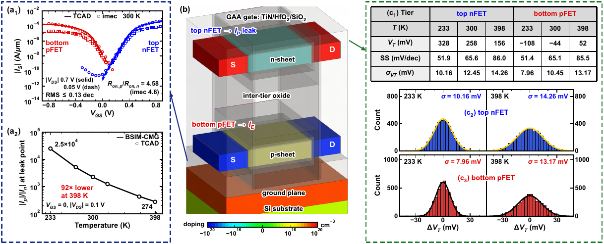
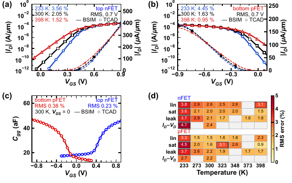
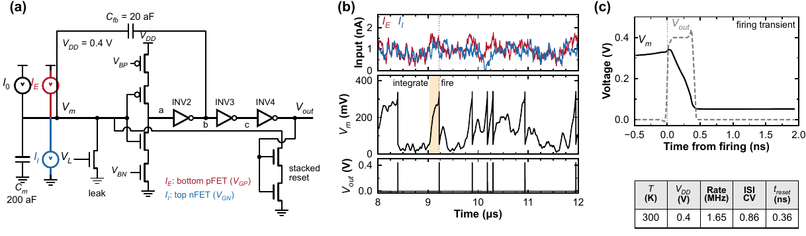
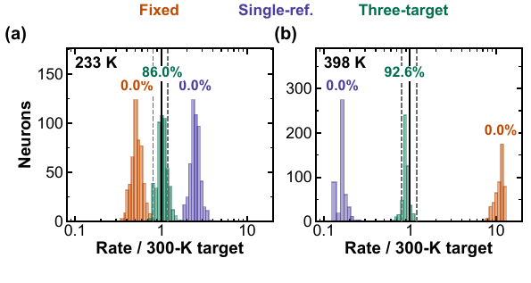
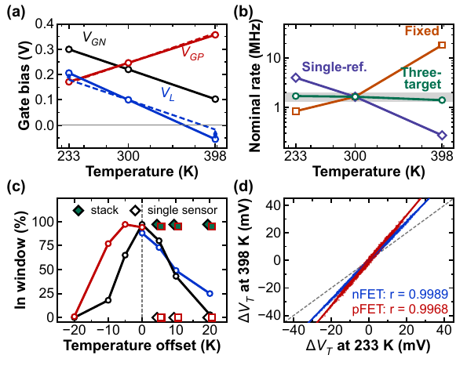
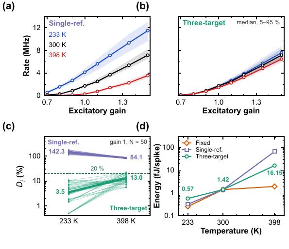

# Temperature-Robust CFET Spiking Neurons Through Coordinated Synaptic and Leakage-Bias Correction

**Heating or cooling shifts the n/p current balance inside a stacked CFET, so a CFET spiking neuron's firing rate drifts with temperature. Correcting three bias currents, with a per-neuron trim done once at room temperature, keeps 79.2% of 500 mismatched neurons on target from −40 °C to 125 °C. That nearly matches recalibrating at every temperature (80.4%).**

> **Publication status: under review.** A manuscript reporting this work by **Tushar Dudeja and Nawaz Shafi** (Department of Micro and Nanoelectronics, Vellore Institute of Technology) has been submitted to **IEEE Transactions on Nanotechnology**.
>
> This work has been submitted to the IEEE for possible publication. Copyright may be transferred without notice, after which this version may no longer be accessible.
>
> **Please note.** The text on this page is a summary written for this repository, not the manuscript text. The figures and results are the authors' own and are shown here for information. Do not copy, adapt or redistribute any part of this page without the authors' written permission. Simulation decks, model cards and netlists are **not released**.

---

## 1. The problem

In a complementary FET (CFET), the nFET sits directly on top of the pFET. In a CFET leaky integrate-and-fire neuron, the bottom pFET provides the excitatory current, while the top nFET provides both the inhibitory current and the membrane leakage. The two tiers do not respond to temperature in the same way, so as the chip warms or cools, the balance between excitation, inhibition and leakage moves, and the neuron fires at a different rate for the same input.

The usual fix of resizing one transistor relative to the other is unavailable in a CFET, because both tiers share the same nanosheet width. Over the automotive Grade-1 range (233-398 K), this project asks: **can bias correction, with a single trim per neuron at room temperature, hold the firing rate of a whole mismatched population?**

## 2. From calibrated device to neuron

<em>Figure 1. The calibrated CFET. TCAD is anchored to imec's measured transfer curves at 300 K, and the tier leakage ratio, threshold voltages, swing and threshold-voltage spread are then predicted at other temperatures.</em>

- **Device.** A top-nFET over bottom-pFET CFET with one gate-all-around nanosheet per tier, following imec's 48 nm-pitch device: gate length 25 nm, sheet width 23 nm, thickness 6.5 nm. Each tier's gate work function and contact resistivity are fitted to imec's 300 K data, within 0.13 decade log-RMS, and then frozen. **All temperature behavior is a TCAD prediction.**
- **Why the balance shifts.** The nFET threshold falls by about 1.03 mV/K and the pFET threshold rises by about 0.95 mV/K. At zero gate bias, where the leak transistor sits, the p/n leakage ratio drops 92-fold, from about 2.5 × 104 at 233 K to 274 at 398 K.
- **Variability.** Metal-grain and nanosheet-geometry variation over 2,000 TCAD samples gives a threshold spread that grows with temperature: 10.2 → 14.3 mV (nFET) and 8.0 → 13.2 mV (pFET) from 233 to 398 K.
- **Compact model.** Temperature-dependent BSIM-CMG cards are fitted to the TCAD curves. 44 of 54 curves are within 3% RMS, with a worst case of 4.66%. A 323 K set was held out as a check, and gate capacitance matches within 0.4%.

<em>Figure 2. Compact-model fit across temperature: drain current for both tiers at three temperatures, gate capacitance, and the RMS error of every fitted and held-out curve.</em>

## 3. The neuron and the correction schemes

<em>Figure 3. The CFET neuron at 300 K (HSPICE): circuit, noisy synaptic inputs with the resulting membrane and output waveforms, and a single firing event. It fires at 1.65 MHz from a 0.4 V supply.</em>

Bias replicas (copies of each CFET tier) set the excitatory and inhibitory currents, and a third top-tier transistor sets the leakage. Five bias policies are compared on the same 500 mismatched neurons:

| Policy | Per-neuron trim | Shared biases as temperature changes |
|---|---|---|
| Fixed | none | held at 300 K values |
| Trim only | once, at 300 K | held at 300 K values |
| Single-reference | once, at 300 K | one tier's correction copied to the other gates |
| **Three-target** | once, at 300 K | excitatory, inhibitory and leakage currents each held at their 300 K values |
| Recalibration (benchmark) | at every temperature | re-solved at every temperature |

A neuron **passes** if it fires within ±20% of its 300 K target, and passes **jointly** only if it does so at 233, 300 and 398 K.

## 4. Results

<em>Figure 4. Firing rates of the 500 neurons, relative to target, at 233 K and 398 K for three policies. Only the three-target policy keeps the population inside the ±20% window.</em>

| Policy | Joint acceptance (500 neurons) |
|---|---|
| Fixed | 0.0% |
| Trim only | 0.0% |
| Single-reference | 0.0% |
| **Three-target** | **79.2%** (95% CI 75.4-82.5%) |
| Recalibration | 80.4% (95% CI 76.7-83.6%) |

- **Single-reference correction fails.** It fixes the inhibitory current, but by copying one shift to every gate it over-corrects the others: the nominal neuron's rate error flips to +144% at 233 K and −84% at 398 K. With fixed biases, the rate falls by 49% at 233 K and rises 11.3-fold at 398 K.
- **The leakage term is what matters.** In a paired 200-neuron ablation, matching the inputs alone passes 47.0%, correcting the leakage alone passes none, and doing both passes 78.5%. **Adding leakage correction gains 31.5 percentage points.**
- **Why one room-temperature trim is enough.** Each device keeps the sign and rank of its threshold offset across temperature (correlation ≥ 0.996), and the offset simply scales. A trim that cancels the offset at 300 K leaves at most 26% of it at either extreme.
- **Sensor placement.** If the bottom tier runs 5-20 K cooler than the top, a single top-tier temperature sensor fails every neuron. A replica stack that represents both tiers keeps 95-97%.
- **Rate coding and energy.** The corrected neuron's rate still rises monotonically with input at every temperature, and it uses **1.42 fJ per spike** from the supply at 300 K (excluding bias generation, sensing and trim storage).

<em>Figure 5. Shared gate biases under the two reference schemes, nominal-neuron firing rate versus temperature, the effect of temperature offsets between replica and neuron, and the per-device threshold offsets at the two temperature extremes.</em>

<em>Figure 6. Firing rate versus input gain for 50 neurons under single-reference and three-target correction, each neuron's rate change from its 300 K value, and supply energy per spike.</em>

## 5. Limitations

- All results are simulated. The device is calibrated to published 300 K measurements, and its temperature behavior is a TCAD prediction.
- Threshold-voltage variability is modeled in subthreshold only. Mobility, resistance and capacitance variations are omitted.
- Synaptic inputs are modeled as replica currents driven by random activity waveforms, not as individual synapse transistors.
- The energy figure covers the neuron supply only, not the bias generators, sensors or trim storage.

## What is not released, and why

The Sentaurus decks, BSIM-CMG model cards, HSPICE netlists and raw data are not published while the manuscript is under review, and the TCAD inputs depend on licensed Synopsys tools. Further detail is available on request.

## Authors

**Tushar Dudeja** and **Nawaz Shafi** (corresponding), Department of Micro and Nanoelectronics, Vellore Institute of Technology, Vellore, India
[LinkedIn](https://linkedin.com/in/tushardudeja) · [GitHub](https://github.com/thetushardudeja1)

© 2026 Tushar Dudeja and Nawaz Shafi. All rights reserved. The manuscript is under review; reuse requires the authors' permission.
